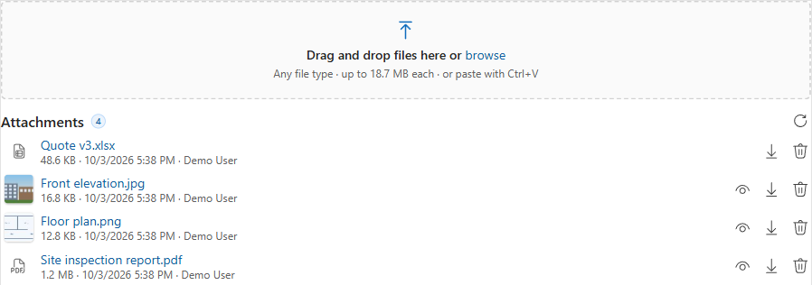
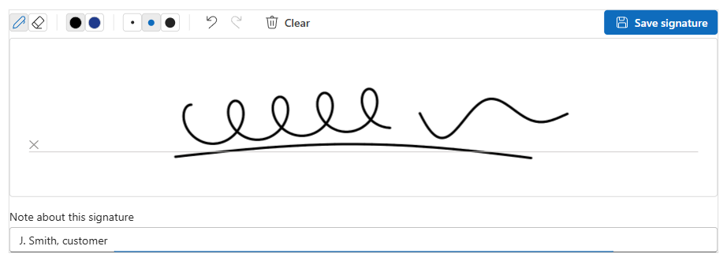

<h1 align="center">Montariva Technology · Solutions</h1>

  Ready-to-use tools for <b>Dynamics 365</b>, <b>Dataverse</b> and the <b>Power Platform</b>, free to download and use. 
  By <a href="https://montariva.com">Montariva Technology</a>, Microsoft Dynamics 365, Power Platform and Azure consulting.

---

## Products

### PCF controls (managed solutions)

Import the managed solution into your environment, then add the control to a form.

| | Product | What it does | Version | Download | Guide |
|---|---|---|---|---|---|
|  | [**File Drop Zone**](pcf-controls/file-drop-zone/) | Drag and drop (or paste) files onto a model-driven form; they're saved as Note attachments on the record. Large files with progress, duplicate handling, preview, download and delete. | 0.3.0 | [MrtFileDropZone_managed.zip](https://github.com/MontarivaTechnology/Solutions/releases/download/FileDropZone-v0.3.0/MrtFileDropZone_managed.zip) | [User guide](pcf-controls/file-drop-zone/user-guide.md) |
|  | [**Signature Pad**](pcf-controls/signature-pad/) | Sign or draw on a form with mouse, pen or finger; saved as a PNG Note attachment. Signature and drawing modes, eraser, undo/redo, a note per image. | 0.2.0 | [MrtSignaturePad_managed.zip](https://github.com/MontarivaTechnology/Solutions/releases/download/SignaturePad-v0.2.0/MrtSignaturePad_managed.zip) | [User guide](pcf-controls/signature-pad/user-guide.md) |

How to import, upgrade or remove a managed solution: [docs/installing-managed-solutions.md](docs/installing-managed-solutions.md)

### XrmToolBox tools

Install them from inside XrmToolBox: **Tool Library** > search the tool name > **Install**.

| Product | What it does | Version | Install |
|---|---|---|---|
| [**Unmanaged Layer Finder**](xrmtoolbox-tools/unmanaged-layer-finder/) | Scans a whole solution for unmanaged (Active) layers and shows what changed, when and by whom. | 1.3.0 | XrmToolBox Tool Library |
| [**Deployment Doctor**](xrmtoolbox-tools/deployment-doctor/) | Explains why a change deployed with a managed solution doesn't show in the target environment (forms, views, web resources, workflows, cloud flows), with guided fixes and shareable reports. | 1.0.0 | XrmToolBox Tool Library |

How to install, update or install offline: [docs/installing-xrmtoolbox-tools.md](docs/installing-xrmtoolbox-tools.md)

## All downloads

Every version is on the **[Releases page](https://github.com/MontarivaTechnology/Solutions/releases)**. Each release is tagged `<Product>-v<version>` (for example `FileDropZone-v0.3.0`) and lists what changed.

## Support

- **Questions, problems or ideas:** [open an issue](https://github.com/MontarivaTechnology/Solutions/issues/new/choose) and pick the product.
- **Business enquiries** (custom development, consulting): [montariva.com](https://montariva.com)
- **Security issues:** please see [SECURITY.md](SECURITY.md) and don't post them publicly.

## License

The products are free to use under the [MIT license](LICENSE).
