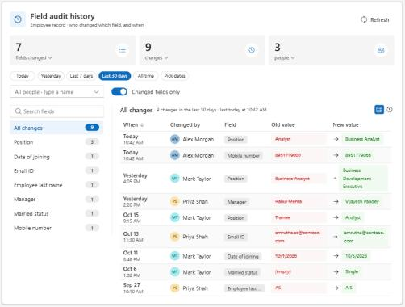

# Field Audit History

See **who changed which field, and when**, right on a Dynamics 365 / Dataverse model-driven form. Pick a field, a period or a person and read only that history, with the old and new value of every change, instead of scrolling through the whole audit log.

| Version | Status | Publisher | Download |
|---|---|---|---|
| **0.1.1** | Preview | Montariva Technology (prefix `mrt`) | **[MrtFieldAuditHistory_managed.zip](https://github.com/MontarivaTechnology/Solutions/releases/download/FieldAuditHistory-v0.1.1/MrtFieldAuditHistory_managed.zip)** |

📘 **[User guide](user-guide.md)**: install, add to a form, every setting explained, security and troubleshooting.

## Features

- **One control, every field**: add it once (best on its own *Audit* tab). It lists every audited column of the table, not only the ones on the form.
- **Change count per field**: see at a glance which fields changed and how often.
- **Old and new value**: every change shows the value before and after, formatted the way the form shows it (lookup names, choice labels, dates).
- **Periods**: Today, Yesterday, Last 7 days, Last 30 days, All time, or pick a single day or a date range.
- **Search by person**: start typing a name and pick from suggestions (people who changed this record first, then any user in the environment) to see only what they changed, with counts for the whole period.
- **Clickable summary**: fields changed, number of changes and people for the period. Click a number to see the details in a small table with bars (which fields, which days, who and how much); click a row to jump to that field, day or person.
- **Table or timeline**: a sortable table (when, changed by, field, old value, new value) with a header that stays visible, or a timeline grouped by day. Switch with one click.
- **Fast on long histories**: only the chosen period is read, in pages, with *Load older changes* for more.
- **Read-only**: it never changes the record or the audit log.
- **Modern UI**: React + Fluent UI v9, follows the app's theme; compact layout on narrow sections and phones.

## Requirements

- A Dynamics 365 / Dataverse environment with model-driven apps.
- **System Administrator** or **System Customizer** to import the solution and change forms.
- **Auditing** turned on for the environment, the table and the columns you want to follow.
- Users need the **View Audit History** and **View Audit Summary** privileges.

## Install

1. Download **[MrtFieldAuditHistory_managed.zip](https://github.com/MontarivaTechnology/Solutions/releases/download/FieldAuditHistory-v0.1.1/MrtFieldAuditHistory_managed.zip)**.
2. In [make.powerapps.com](https://make.powerapps.com): **Solutions** > **Import solution** > pick the zip > **Next** > **Import**. More detail: [installing managed solutions](../../docs/installing-managed-solutions.md).
3. On the table, add a **single line text** column to host the control (its value is never read or changed).
4. In the form designer: add an **Audit** tab, put that column on it, then **Components** > **+ Component** > **Field Audit History (Montariva Technology)** > **Done**. Turn off the column's label > **Save and publish**.

The [user guide](user-guide.md) walks through every step.

## Settings

| Setting | Default | Description |
|---|---|---|
| Title | *(empty)* | Heading at the top. Empty = *Field audit history*. |
| Starting period | Last 30 days | Period selected when the form opens: Today, Yesterday, Last 7 days, Last 30 days or All time. |
| Starting view | Table | *Table* or *Timeline*. Users can switch; narrow sections and phones use the timeline. |
| Hide these fields | *(empty)* | Comma-separated column logical names to leave out, e.g. `modifiedon,versionnumber`. |
| Audit events per load | *(empty)* | 25-500. Empty = 100. More events are read with *Load older changes*. |
| List height (px) | *(empty)* | 200-2000. Empty = 520. The field list and the changes scroll inside this height, so the form doesn't grow with long histories. |

## Versions

See the [Releases page](https://github.com/MontarivaTechnology/Solutions/releases?q=FieldAuditHistory) for all versions and what changed.

## Support

[Open an issue](https://github.com/MontarivaTechnology/Solutions/issues/new/choose) and choose **Field Audit History**.
