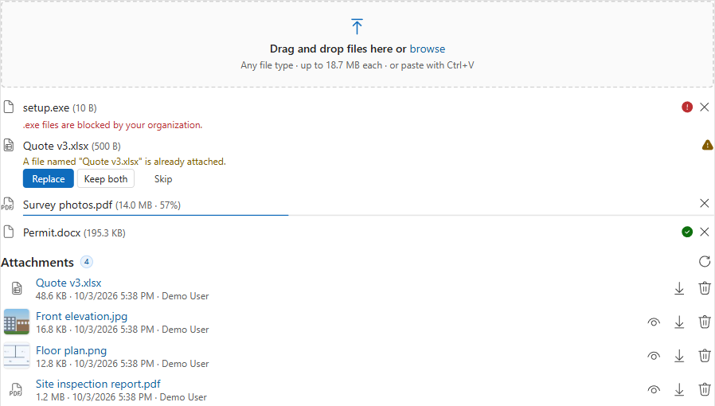
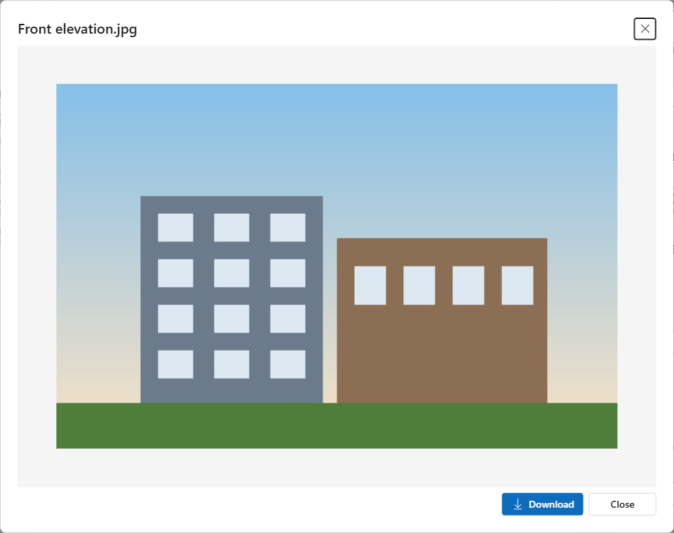

# File Drop Zone

Drag-and-drop file upload for Dynamics 365 / Dataverse model-driven forms. Files are saved as **Note attachments** on the current record, so they show in the timeline and work with everything that already reads Notes.

| Version | Status | Publisher | Download |
|---|---|---|---|
| **0.3.0** | Preview | Montariva Technology (prefix `mrt`) | **[MrtFileDropZone_managed.zip](https://github.com/MontarivaTechnology/Solutions/releases/download/FileDropZone-v0.3.0/MrtFileDropZone_managed.zip)** |

📘 **[User guide](user-guide.md)**: install, add to a form, every setting explained, security and troubleshooting.

## Features

- **Drop, browse or paste**: drop files or whole folders, pick them with the file dialog, or paste screenshots with Ctrl+V.
- **Follows your environment's rules**: reads the maximum file size, blocked extensions and blocked/allowed MIME types, so users see the reason *before* uploading instead of a server error.
- **Large files**: files over 4 MB are sent in blocks with a progress bar and a Cancel button.
- **Duplicates**: if a file with the same name is already attached, choose **Replace**, **Keep both** or **Skip**.
- **Existing attachments**: list with thumbnails for images, preview (images, PDF, text), download and delete.
- **Safe defaults**: read-only forms show the list without upload or delete; new records ask to be saved first; Dataverse security always applies.
- **Modern UI**: React + Fluent UI v9, follows the app's theme.

## Requirements

- A Dynamics 365 / Dataverse environment with model-driven apps.
- **System Administrator** or **System Customizer** to import the solution and change forms.
- The table must allow notes (attachments). Account, Contact, Case, Lead and Opportunity already do.

## Install

1. Download **[MrtFileDropZone_managed.zip](https://github.com/MontarivaTechnology/Solutions/releases/download/FileDropZone-v0.3.0/MrtFileDropZone_managed.zip)**.
2. In [make.powerapps.com](https://make.powerapps.com): **Solutions** > **Import solution** > pick the zip > **Next** > **Import**. More detail: [installing managed solutions](../../docs/installing-managed-solutions.md).
3. On the table, add a **single line text** column to host the control (the control never changes its value).
4. In the form designer: select that column > **Components** > **+ Component** > **File Drop Zone (Montariva Technology)** > set the options > **Done** > **Save and publish**.

The [user guide](user-guide.md) walks through every step with screenshots.

## Settings

| Setting | Default | Description |
|---|---|---|
| Allowed file types | *(empty)* | Optional, e.g. `.pdf,.docx,.png`. Empty = everything the environment allows. |
| Max file size (MB) | *(empty)* | Optional, to be stricter than the environment limit on this form. |
| Max files per drop | 10 | How many files can be added in one go. |
| Note title | *(empty)* | Title for each Note. Empty = file name. |
| Show existing attachments | Yes | List the record's attachments. |
| Allow delete | Yes | Show the delete button (security roles still apply). |
| Show image thumbnails | Yes | Small previews for image attachments. |

> The environment's *Maximum file size* (System Settings > Email) applies to the encoded size, so the real file limit is about 3/4 of it (the default 5,120 KB setting allows files up to about 3.7 MB).

## Versions

See the [Releases page](https://github.com/MontarivaTechnology/Solutions/releases?q=FileDropZone) for all versions and what changed.

## Support

[Open an issue](https://github.com/MontarivaTechnology/Solutions/issues/new/choose) and choose **File Drop Zone**.
