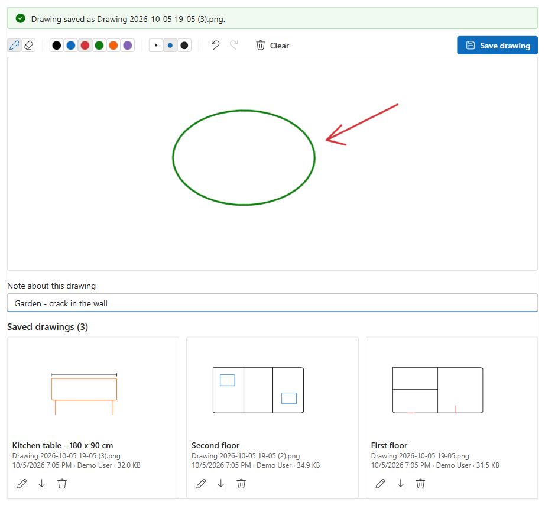

# Signature Pad

Sign or draw on a Dynamics 365 / Dataverse model-driven form with a mouse, pen or finger. The picture is saved as a **PNG Note attachment** on the current record (for example `Signature 2026-10-05 14-30.png`), so it shows in the timeline and works with flows, reports and Word templates.

| Version | Status | Publisher | Download |
|---|---|---|---|
| **0.2.0** | Preview | Montariva Technology (prefix `mrt`) | **[MrtSignaturePad_managed.zip](https://github.com/MontarivaTechnology/Solutions/releases/download/SignaturePad-v0.2.0/MrtSignaturePad_managed.zip)** |

📘 **[User guide](user-guide.md)**: install, add to a form, every setting explained, security and troubleshooting.

## Features

- **Signature or Drawing mode**: one cropped signature per record, or a bigger canvas with six colours and a list of saved drawings.
- **Eraser**: rub out part of the picture and draw that part again.
- **Undo / redo / clear**: every stroke, eraser stroke and *Clear* can be undone (Ctrl+Z / Ctrl+Y).
- **Mouse, pen and touch**: smooth lines; pen pressure makes the line thicker.
- **Note with each image**: a short note such as *First floor* or the signer's name, saved with the image and shown as its title. Optional, required or off.
- **Edit saved images**: open a saved image on the pad, change it and save it back.
- **Newest first**: saved images are listed newest first, with download and delete.
- **Your file name**: `Signature.png`, `Customer signature 2026-10-05 14-30.png`... Replace the earlier image or keep them all.
- **Required signature**: optionally writes the file name into the host column, so business rules and views can check for it.
- **Modern UI**: React + Fluent UI v9, follows the app's theme.

## Requirements

- A Dynamics 365 / Dataverse environment with model-driven apps.
- **System Administrator** or **System Customizer** to import the solution and change forms.
- The table must allow notes (attachments). Account, Contact, Case, Lead and Opportunity already do.

## Install

1. Download **[MrtSignaturePad_managed.zip](https://github.com/MontarivaTechnology/Solutions/releases/download/SignaturePad-v0.2.0/MrtSignaturePad_managed.zip)**.
2. In [make.powerapps.com](https://make.powerapps.com): **Solutions** > **Import solution** > pick the zip > **Next** > **Import**. More detail: [installing managed solutions](../../docs/installing-managed-solutions.md).
3. On the table, add a **single line text** column to host the control.
4. In the form designer: select that column > **Components** > **+ Component** > **Signature Pad (Montariva Technology)** > set the options > **Done** > **Save and publish**.

The [user guide](user-guide.md) walks through every step with screenshots.

## Settings

| Setting | Default | Description |
|---|---|---|
| Mode | Signature | *Signature* (cropped, shown in place of the pad once saved) or *Drawing* (pad + list of saved drawings). |
| Image name | *(empty)* | File name without `.png`. Empty = `Signature` / `Drawing`. |
| Add date to file name | Yes | `Signature 2026-10-05 14-30.png` instead of `Signature.png`. |
| When a new image is saved | Replace | Replace the earlier image(s) with the same name, or keep them all. |
| Note title | *(empty)* | Note subject. Empty = image name. |
| Note with each image | Optional | Optional / Required / Off. |
| Pen colour | *(empty)* | Starting colour, e.g. `#1F3B8C`. Empty = black. |
| Pen width (px) | *(empty)* | 1-20. Empty = 3. |
| Pad height (px) | *(empty)* | 100-1200. Empty = 200 (signature) / 360 (drawing). |
| Image background | White | White or transparent PNG. |
| Allow delete | Yes | Show the delete button (security roles still apply). |
| Fill host field when saved | No | Write the newest file name into the host column (the form then needs saving). |

## Versions

See the [Releases page](https://github.com/MontarivaTechnology/Solutions/releases?q=SignaturePad) for all versions and what changed.

## Support

[Open an issue](https://github.com/MontarivaTechnology/Solutions/issues/new/choose) and choose **Signature Pad**.
